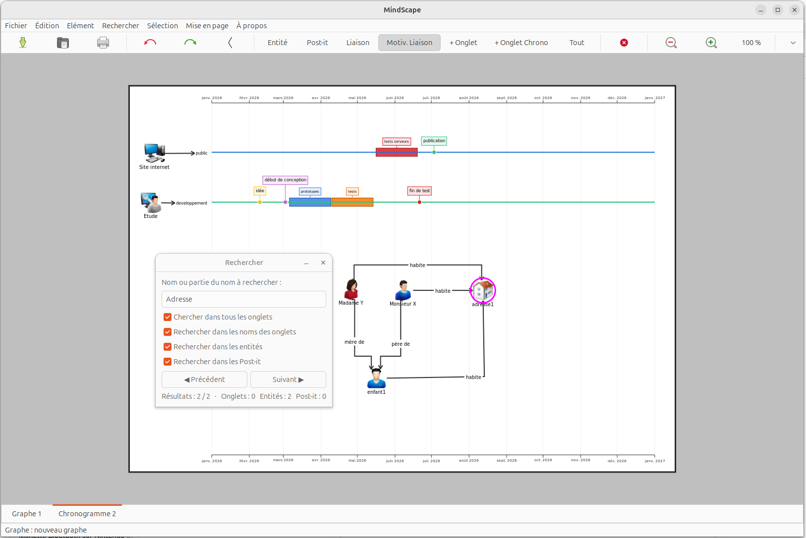

# Mindscape

**Logiciel de création de graphes relationnels et chronologiques**

MindScape est une application de bureau développée en Python, destinée à Ubuntu et Windows, aussi exécutable depuis une clé USB.

## Fonctionnalités

- Réalisation de graphes relationnels et chronologiques
- Gestion des entités et des liaisons
- Ajout de Post-it
- Organisation automatique des graphes
- Exportation pdf et impression A3 A4

## Plateformes

- Ubuntu
- Windows




## Fonctionnalités

- **Graphes d'entités** : créez des entités avec icône et nom, reliez-les par des liaisons nommées, ajoutez des post-it.
- **Motivation des liaisons** : décrivez le pourquoi d'une liaison et affichez-le sous son nom (bouton *Motiv. Liaison*).
- **Graphes chrono** : placez des événements datés et des périodes sur une échelle de temps, avec des lignes (chronogrammes) rattachées à une entité.
- **Plusieurs onglets** : un onglet par graphe ou par chronogramme (*+ Onglet*, *+ Onglet Chrono*).
- **Recherche** : retrouvez une entité, un post-it ou un onglet par son nom, dans un ou plusieurs onglets.
- **Édition confortable** : annuler / rétablir, copier / coller, zoom, impression.

## Installation (Ubuntu)

> À compléter et à vérifier : liste exacte des dépendances.

```bash
sudo apt install python3 python3-gi gir1.2-gtk-3.0
git clone https://github.com/<votre-compte>/<votre-depot>.git
cd <votre-depot>
python3 mindscape.py
```

### Lanceur dans le menu des applications

Un fichier `.desktop` est fourni pour lancer Mindscape depuis le menu d'Ubuntu.

## Utilisation rapide

1. Cliquez sur **Entité** pour ajouter une entité, puis sur **Liaison** pour relier deux entités.
2. Ajoutez un **Post-it** pour une note libre.
3. Ouvrez un onglet chrono avec **+ Onglet Chrono** pour placer des événements et des périodes dans le temps.
4. Enregistrez votre travail depuis le menu **Fichier**.

## Soutenir le projet

Mindscape est développé sur mon temps libre. Si l'outil vous est utile, vous pouvez soutenir son auteur : *(lien à ajouter)*.

## Licence

© 2026 *(votre nom)*. Tous droits réservés.

Mindscape est **gratuit pour un usage personnel et non commercial**, conformément à la licence [PolyForm Noncommercial 1.0.0](https://polyformproject.org/licenses/noncommercial/1.0.0/) (voir le fichier `LICENSE`).

**Usage professionnel ou commercial** (entreprise, activité rémunérée, intégration dans un produit ou service) : une autorisation préalable est nécessaire. Contactez l'auteur : *(adresse e-mail)*.

## Contact

*(à compléter)*
